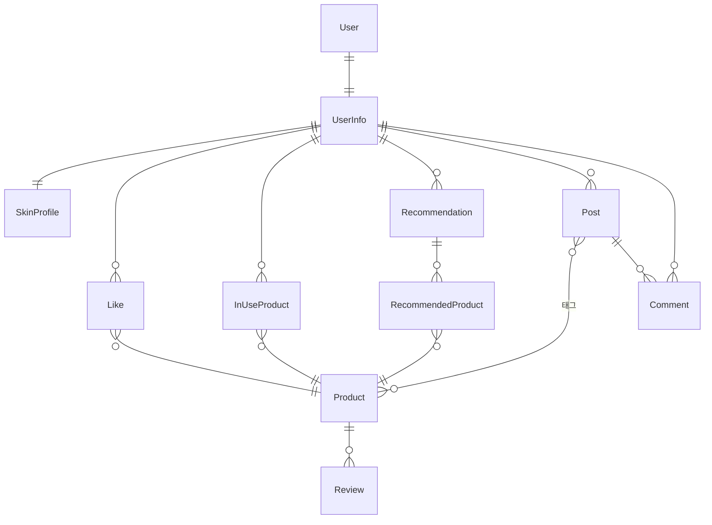

# 데이터 모델과 인증

README에서 링크하는 세부 문서입니다.

## 데이터 모델

`Product`에 두 개의 특별한 컬럼이 있습니다.

- `embedding` — `pgvector(1536)`. 리뷰 요약을 임베딩한 결과이고 코사인 정렬의 재료입니다
- `form` — `ArrayField`. 한 제품이 여러 제형에 걸칠 수 있어 배열로 두고 overlap으로 매칭합니다

## 인증과 보안

- **JWT 이중 토큰** — Access 30분(인메모리), Refresh 7일(`HttpOnly` 쿠키). 회전과 블랙리스트를 적용합니다. 블랙리스트는 SimpleJWT의 DB 기반 앱을 씁니다
- **IDOR 차단** — 자신이 쓰지 않은 게시글과 댓글의 수정, 삭제를 서버에서 막습니다. 프론트에서 버튼을 숨기는 것만으로는 API 직접 호출을 막지 못합니다
- **호출 한도** — 대화 100회/일, 추천 20회/일
- **시크릿 관리** — 모든 키를 `.env`로 분리하고 저장소에 커밋하지 않습니다
